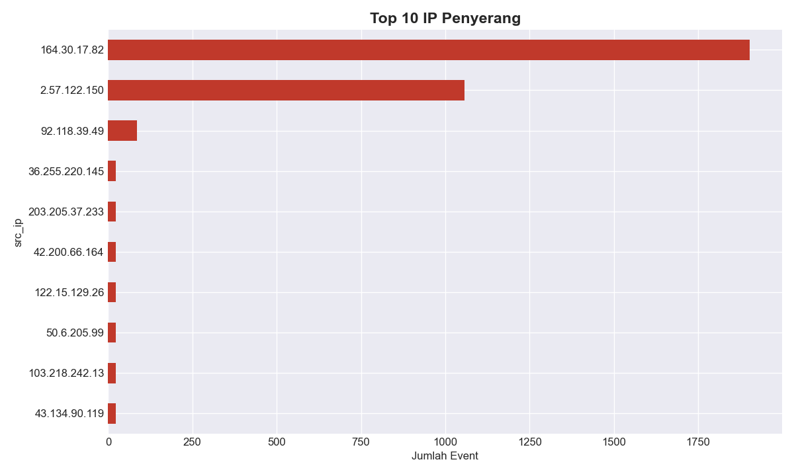
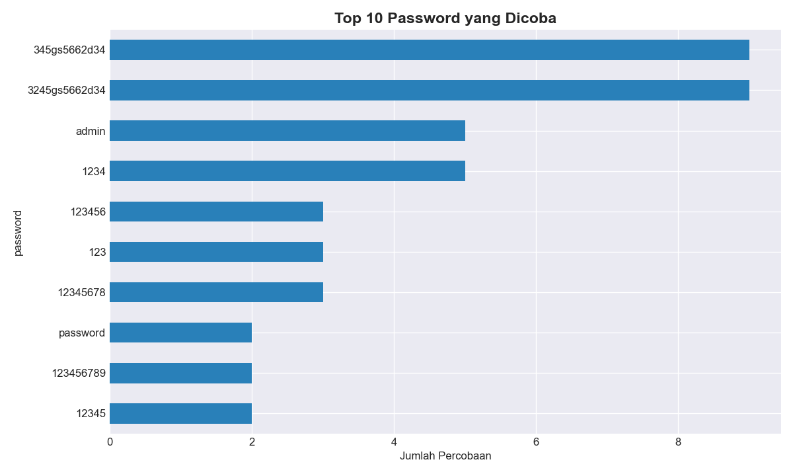
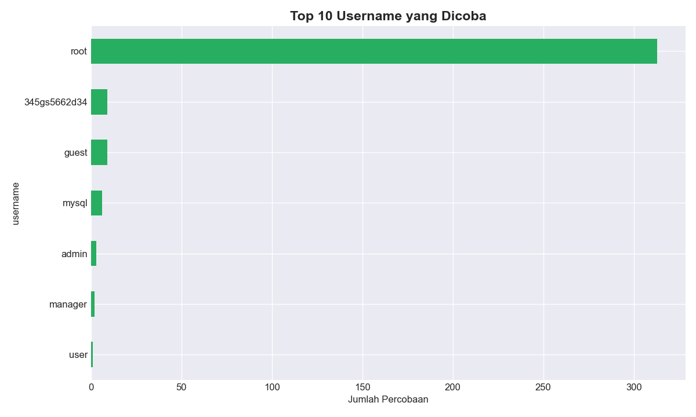
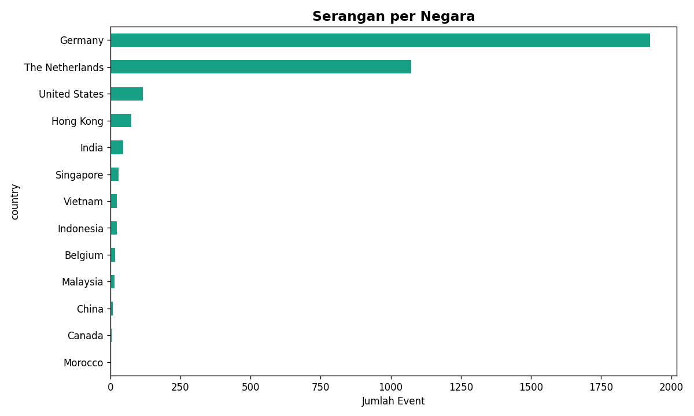
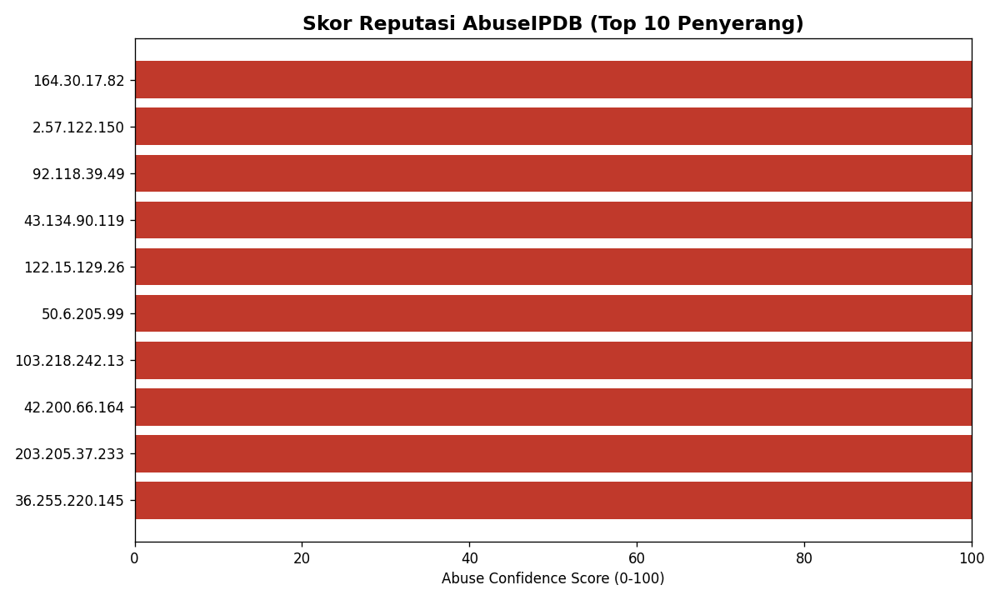
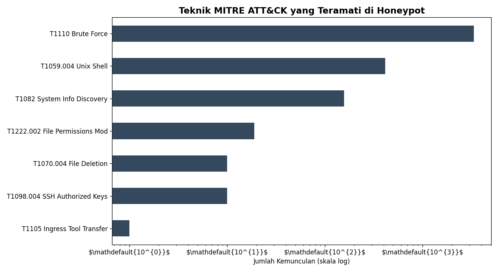
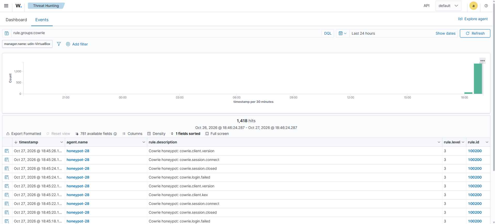
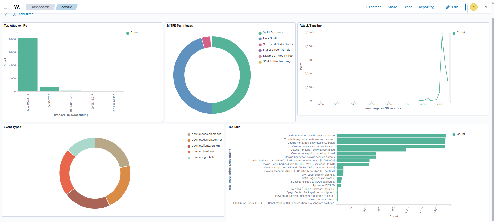

# SSH Honeypot — Analisis Serangan Dunia Nyata dengan Cowrie

Men-deploy honeypot SSH (Cowrie) di VPS publik, membiarkannya menangkap serangan nyata dari internet, lalu menganalisis telemetri yang terkumpul: statistik serangan, enrichment IP (GeoIP + reputasi AbuseIPDB), dan pemetaan perilaku penyerang ke framework **MITRE ATT&CK**.

Proyek ini mensimulasikan alur kerja seorang **SOC Analyst**: dari mengumpulkan log, memperkaya data, mengidentifikasi ancaman, sampai menuliskannya menjadi temuan yang bisa ditindaklanjuti.

---

## Ringkasan

| | |
|---|---|
| **Sensor** | Cowrie SSH Honeypot (low-interaction) |
| **Platform** | VPS publik (Ubuntu 22.04), region Singapura |
| **Durasi pengamatan** | ~11 jam (sampel awal) |
| **Total event terekam** | **3.355** |
| **IP penyerang unik** | **27** (dari ~13 negara) |
| **Botnet teridentifikasi** | Outlaw/Dota, XSec scanner |

---

## Arsitektur

```
Internet (penyerang/bot)
        │  ketuk port 22
        ▼
┌─────────────────────────────────────┐
│  VPS Publik (Ubuntu 22.04)          │
│                                     │
│   iptables: 22 ──redirect──► 2222   │
│                                │    │
│                          ┌─────▼─────┐
│                          │  Cowrie   │ ← merekam semua aktivitas
│                          └───────────┘
│                                     │
│   port 2200 ──► SSH admin (aman)    │
└─────────────────────────────────────┘
```

**Prinsip desain utama — pemisahan jalur:**
- **Port 22** → umpan, dibelokkan ke Cowrie. Semua serangan masuk ke sini.
- **Port 2200** → SSH admin asli, autentikasi berbasis SSH key. Penyerang tidak pernah menyentuh sistem sebenarnya.
- Cowrie berjalan sebagai user non-root (*least privilege*).

---

## Teknologi

- **Cowrie** — SSH/Telnet honeypot
- **Linux** (Ubuntu), `iptables` (NAT redirect), `ufw`, `systemd` (auto-start, tahan reboot)
- **Python** (`pandas`, `matplotlib`, `requests`) — pipeline analisis & visualisasi
- **GeoIP** (ip-api.com) & **AbuseIPDB** — threat intelligence / enrichment
- **MITRE ATT&CK** — framework klasifikasi perilaku penyerang

---

## Ringkasan Setup

1. **Hardening** — SSH admin dipindah ke port non-standar (2200), autentikasi SSH key, firewall `ufw`.
2. **Deploy Cowrie** — virtualenv Python, user non-root khusus, listen di port 2222.
3. **Redirect** — `iptables` membelokkan port 22 → 2222 agar honeypot tampak seperti SSH sungguhan.
4. **Persistence** — Cowrie dijadikan `systemd service`; rule `iptables` disimpan via `iptables-persistent` agar tahan reboot.
5. **Validasi** — uji serangan terkontrol, konfirmasi event terekam di log JSON.

> Catatan keamanan: IP server disamarkan di dokumentasi ini. Honeypot diisolasi dari jaringan pribadi (VPS terpisah).

---

## Temuan

### 1. Volume & konsentrasi serangan
Dua IP mendominasi ~88% dari seluruh trafik — pola khas bot brute-force yang gigih, bukan serangan tersebar merata.



### 2. Kredensial yang dicoba
Bot menyasar username/password default dan lemah (mayoritas `root` + password umum) — bukti pentingnya kebijakan kredensial kuat.




### 3. Asal geografis & infrastruktur
Serangan datang dari ~13 negara. **Temuan kunci:** hampir semua IP milik penyedia **hosting/cloud** (bukan ISP residensial) — penyerang menggunakan server sewaan/terkompromi, bukan komputer pribadi.



### 4. Reputasi IP (AbuseIPDB)
**25 dari 27 IP** memiliki abuse confidence score **100/100** — dikonfirmasi jahat oleh komunitas keamanan global. Beberapa sudah dilaporkan **puluhan ribu kali** (satu IP: 42.000+ laporan). Honeypot menangkap *known bad actors*, bukan trafik acak.



### 5. Perilaku penyerang (MITRE ATT&CK)
Perintah yang dijalankan penyerang dipetakan ke teknik MITRE ATT&CK:



| Taktik | Teknik (ID) | Bukti di honeypot |
|---|---|---|
| Credential Access | **T1110** Brute Force | Ribuan percobaan login dari 27 IP |
| Initial Access | **T1078** Valid Accounts | Login sebagai `root` dengan kredensial tebakan |
| Persistence | **T1098.004** SSH Authorized Keys | Menanam kunci SSH penyerang ke `authorized_keys` |
| Defense Evasion | **T1222.002** Linux File Permissions | `chattr -ia` / `chmod -R go=` mengunci key |
| Defense Evasion | **T1070.004** File Deletion | `rm -rf .ssh`, hapus skrip jejak |
| Discovery | **T1082** System Info Discovery | `uname -a`, verifikasi shell (`$$`, aritmetika) |
| Execution | **T1059.004** Unix Shell | `sh -c '...'` |
| Ingress Tool Transfer | **T1105** | Upaya unduh & jalankan `setup.sh` / `clean.sh` |

### 6. Identifikasi botnet
- **Outlaw / Dota botnet** — signature `mdrfckr` pada payload penanaman SSH key. Kampanye cryptomining SSH yang terdokumentasi. Pola: hapus `authorized_keys` korban → tanam kunci penyerang → kunci file dengan `chattr`.
- **XSec scanner** — ratusan `echo xsec` berulang, penanda alat pemindai otomatis.

### 7. Observasi menarik
Beberapa bot menjalankan tes verifikasi shell (evaluasi aritmetika `$((a*b+c))`, PID `$$`) sebelum mengirim payload — teknik untuk mendeteksi sandbox/honeypot. Karena Cowrie tidak mengevaluasi aritmetika tersebut, sebagian bot kemungkinan mengenali lingkungan sebagai honeypot dan berhenti. Ini menegaskan pentingnya realisme honeypot.

---

## Lessons Learned

- Server dengan IP publik mulai diserang dalam **hitungan menit** setelah online — ancaman latar belakang internet bersifat konstan dan otomatis.
- Mayoritas serangan berasal dari **infrastruktur cloud/hosting**, bukan perangkat residensial.
- **Enrichment** (GeoIP + reputasi) mengubah IP anonim menjadi intelijen yang dapat ditindaklanjuti — inti pekerjaan SOC.
- Pemisahan jalur admin/umpan dan prinsip *least privilege* krusial untuk men-deploy honeypot dengan aman.

---

## Struktur Repo

```
.
├── README.md
├── analyze.py          # statistik serangan → grafik 1-5
├── geoip.py            # enrichment GeoIP → grafik 6 + CSV
├── abuseipdb.py        # enrichment reputasi → grafik 7 + CSV
├── mitre.py            # pemetaan MITRE ATT&CK → grafik 8
├── 01_top_ip.png ... 08_mitre_attack.png
└── .gitignore          # menutup apikey.txt & log mentah
```

> `cowrie.json` (log mentah) dan `apikey.txt` sengaja **tidak** di-commit (lihat `.gitignore`) — praktik keamanan dasar untuk tidak mengekspos data sensitif/kredensial.

---

## Integrasi Real-Time ke Wazuh SIEM

Setelah analisis batch, log honeypot diintegrasikan ke **Wazuh SIEM** secara **real-time** — tiap serangan yang masuk ke honeypot langsung memicu alert di dashboard dalam hitungan detik, dengan pemetaan MITRE ATT&CK otomatis.

### Arsitektur

```
VPS Honeypot (publik)                    Home Lab (VirtualBox)
┌──────────────────────┐                 ┌──────────────────────┐
│  Cowrie honeypot      │                 │  Wazuh SIEM Server    │
│  + Wazuh agent        │ ===Tailscale==> │  (manager+indexer+    │
│  (100.115.11.109)     │   mesh VPN      │   dashboard)          │
│                       │   terenkripsi   │  (100.66.89.36)       │
└──────────────────────┘                 └──────────────────────┘
       log event  ──────────────────────────► alert real-time
```

### Tantangan & solusi
SIEM berada di lab lokal (di balik NAT rumah), honeypot di internet publik — keduanya tidak bisa saling terhubung langsung. Membuka port router untuk SIEM berisiko (mengekspos SIEM ke internet). Solusinya: **Tailscale** — mesh VPN berbasis WireGuard yang menghubungkan VPS dan SIEM lewat tunnel terenkripsi **tanpa membuka satu pun port router**. Wazuh agent di VPS mengirim log ke IP Tailscale SIEM, aman dan real-time.

### Custom Detection Rules

Rules ditulis berdasarkan perilaku penyerang nyata yang teramati, dipetakan ke MITRE ATT&CK:

| Rule ID | Deteksi | Level | MITRE |
|---|---|---|---|
| 100201 | Login berhasil ke honeypot | 8 | T1078 Valid Accounts |
| 100202 | Eksekusi perintah shell | 6 | T1059.004 Unix Shell |
| 100203 | **SSH key injection** (Outlaw botnet) | **12** | T1098.004 SSH Authorized Keys |
| 100204 | Ingress tool transfer (wget/curl) | 10 | T1105 |

Contoh definisi rule (deteksi SSH key injection — upaya persistence):
```xml
<rule id="100203" level="12">
  <if_sid>100202</if_sid>
  <field name="input">authorized_keys</field>
  <description>Cowrie: SSH KEY INJECTION dari $(src_ip) - persistence [T1098.004]</description>
  <mitre>
    <id>T1098.004</id>
  </mitre>
</rule>
```

### Hasil
Serangan asli dari internet muncul real-time di dashboard Wazuh dengan level prioritas dan konteks MITRE — persis alur kerja detection engineering seorang SOC analyst.



**Dashboard visual SOC** — top attacker IP, distribusi teknik MITRE, timeline serangan, jenis event, dan rule yang paling sering terpicu, semua dari data serangan live:


### Keterampilan yang didemonstrasikan
Wazuh SIEM administration, custom decoder/rule engineering, MITRE ATT&CK mapping, secure mesh networking (Tailscale/WireGuard), agent-based real-time log forwarding, dan desain arsitektur monitoring yang aman tanpa mengekspos jaringan internal.

## Pengembangan Lanjutan

- Perpanjang pengumpulan data (mingguan) untuk tren yang lebih kaya.
- Forward log Cowrie ke **Wazuh SIEM** untuk korelasi & dashboard real-time.
- Analisis sampel malware yang diunduh penyerang di lingkungan terisolasi.
